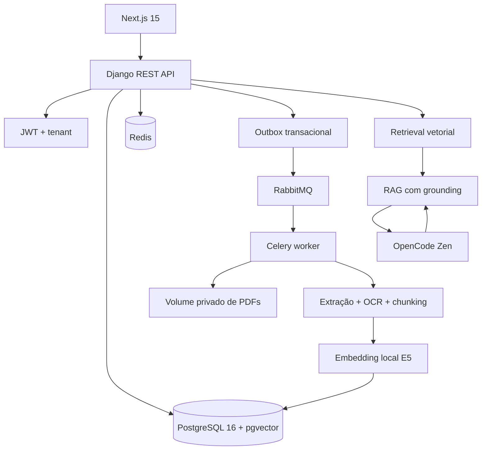

# GovIntel AI

Plataforma multi-tenant de inteligência sobre editais públicos. O sistema
recebe PDFs, processa cada documento de forma assíncrona, transforma o conteúdo
em vetores pesquisáveis e oferece busca semântica e chat com respostas
fundamentadas em citações verificáveis.

O MVP demonstra um fluxo completo e auditável:

```text
empresa/usuário → autenticação → upload privado de PDF
  → fila assíncrona → extração/chunking → embeddings
  → PostgreSQL/pgvector → busca semântica → RAG
  → resposta estruturada com página e trecho comprováveis
```

O projeto trata isolamento, idempotência, segurança de sessão, processamento
at-least-once e validação de citações como requisitos reais de produção. A
especificação geral está em [`SPEC.md`](SPEC.md); o estado operacional fica em
[`context.md`](context.md) e [`memory.md`](memory.md).

## O que o sistema resolve

Uma empresa cria sua conta, envia um edital e acompanha o processamento sem
manter uma requisição HTTP aberta durante a leitura do PDF. Depois que o
documento está pronto, o usuário pode:

- listar seus editais com paginação e estado de processamento;
- pesquisar por significado, e não apenas por palavras exatas;
- filtrar a busca por edital;
- conversar com um edital processado;
- receber respostas que apontam para documento, chunk, página e trecho literal;
- obter insuficiência de evidência quando o contexto não sustenta a pergunta.

O sistema não permite que o modelo invente fontes. O LLM pode propor uma
resposta estruturada, mas o backend só aceita citações que existam nos chunks
persistidos, pertençam ao tenant autenticado e contenham o `quote` como
substring exata do texto armazenado.

## Stack

### Backend e domínio

- Python 3.12.14.
- Django 5.2 e Django REST Framework.
- SimpleJWT para access/refresh tokens, rotação, blacklist e reuse detection.
- Celery 5.6 para processamento assíncrono.
- Gunicorn para servir a API no container.
- `pypdf` para extração de texto.
- `pypdfium2` + Tesseract com pacote `por` para OCR local.

### Frontend

- Next.js 15.5.25, React 19 e TypeScript 5.9.
- Vitest e React Testing Library para testes de interface.
- Playwright para o fluxo E2E da demonstração.
- ESLint e Prettier para qualidade e formatação.

### Dados e infraestrutura

- PostgreSQL 16 com extensão pgvector.
- Campo `vector(768)` e índice HNSW com distância cosseno.
- Redis para cache semântico, revisão de dados e throttling.
- RabbitMQ como broker durável do Celery, com publisher confirms e DLQ.
- Docker Compose para reproduzir o ambiente local.
- Volumes privados para PDFs e cache do modelo de embeddings.

### IA

- LLM padrão: OpenCode Zen, via API compatível com OpenAI.
- Modelo padrão: `deepseek-v4-flash`.
- Embeddings padrão: `intfloat/multilingual-e5-base`, localmente em CPU,
  com 768 dimensões.
- Gemini e OpenRouter continuam disponíveis para migração, mas só são usados
  quando selecionados explicitamente.

LLM e embeddings são configurações independentes. Trocar o LLM não exige
reindexação; trocar o modelo de embeddings ou o preprocessamento exige
reindexação explícita.

## Arquitetura em alto nível



Os principais limites de confiança são:

1. o browser envia dados não confiáveis para a API;
2. a API valida entrada, autenticação e tenant antes de acessar o domínio;
3. a fila transporta apenas IDs, nunca PDFs ou prompts integrais;
4. o worker relê o banco e revalida o tenant antes de processar;
5. o texto do PDF e a saída do LLM são tratados como dados, nunca como código;
6. a resposta só chega à UI depois da validação de schema e das citações.

## Fluxo completo do documento

### 1. Identidade e isolamento

O cadastro cria uma empresa e seu usuário proprietário em uma transação. O
tenant não vem de `companyId` enviado pelo cliente: ele é derivado de
`request.user` no backend.

Esse limite é aplicado a editais, arquivos, chunks, conversas, resultados de
busca, cache, tarefas e endpoints administrativos. Um usuário de uma empresa
não acessa recursos de outra alterando IDs no payload ou na URL.

### 2. Upload idempotente

O frontend envia um PDF multipart com `Idempotency-Key`. O backend valida MIME
type, magic bytes `%PDF-`, arquivo vazio, limite de tamanho, metadados e
autorização.

O PDF é armazenado por uma chave interna privada, nunca pelo nome enviado pelo
usuário. A API retorna `202 Accepted` e o estado inicial `PENDING`.

A chave de idempotência é única por empresa, usuário e endpoint. O hash combina
os bytes do PDF em streaming com metadados normalizados, sem depender do
boundary do multipart. Um retry equivalente reaproveita o mesmo edital; um
retry com payload diferente retorna `422` sem criar duplicata.

### 3. Outbox, RabbitMQ e Celery

O upload grava o edital e um evento de outbox na mesma transação. Só depois do
commit o relay publica no RabbitMQ. Isso evita que o worker consuma uma
mensagem antes de o edital estar confirmado no banco.

A mensagem contém somente:

```json
{
  "tenderId": "uuid",
  "jobId": "uuid"
}
```

A task versionada `pipeline.process_tender.v1` tem entrega at-least-once.
Portanto, o processamento é idempotente por `jobId`, possui retry limitado,
lease/heartbeat, confirmação de publicação e dead-letter queue. O ack ocorre
somente depois de persistir o estado e os chunks.

Estados públicos do pipeline:

```text
PENDING → PROCESSING → PROCESSED
                     ↘ FAILED
```

O worker nunca confia em um tenant vindo da mensagem. Ele consulta o edital,
deriva a empresa no banco e revalida autorização antes de ler o arquivo.

### 4. Extração, OCR e chunking

O pipeline lê o PDF no volume privado e preserva página, offsets, conteúdo,
documento de origem e geração do pipeline. Quando uma página não possui camada
de texto, pode rasterizá-la e executar OCR em português. Se o texto continuar
indisponível, o edital termina com um erro de domínio seguro, sem stack trace na
API.

O chunker respeita o limite de 512 tokens do modelo E5 e evita entradas maiores
que o limite do encoder.

### 5. Embeddings locais e pgvector

O embedding padrão é gerado localmente:

```text
documento: passage: <texto do chunk>
consulta:  query: <texto pesquisado>
```

Os vetores são produzidos em batch, normalizados por L2 e armazenados em
`vector(768)`. O modelo é carregado sob demanda e reutiliza cache privado
compartilhado entre API e worker. O PDF e os prompts não são enviados a um
serviço externo de embeddings.

Cada chunk persiste a identidade completa do espaço vetorial: provider, nome e
revisão do modelo, dimensões, normalização, fingerprint do preprocessamento e
geração do pipeline.

O retrieval só compara vetores cuja identidade seja totalmente compatível.
Isso impede misturar embeddings de modelos, revisões ou preprocessamentos
distintos.

### 6. Reindexação segura

O comando abaixo calcula o plano sem alterar dados:

```text
docker compose run --rm api python manage.py reindex_embeddings --dry-run
```

A execução real cria uma geração staged para o corpus selecionado, gera todos
os embeddings, valida contagens e promove a geração em transação. A geração
anterior permanece preservada até uma decisão explícita de rollback:

```text
docker compose run --rm api python manage.py reindex_embeddings
docker compose run --rm api python manage.py reindex_embeddings --rollback-to-generation N --tender-id UUID
```

Não existe fallback silencioso para outro provider. Se a configuração ativa não
combinar com os metadados persistidos, a busca falha fechada ou retorna sem
resultados compatíveis.

### 7. Busca semântica e cache

A busca aplica os filtros de tenant e edital antes da ordenação vetorial. O
índice HNSW acelera a distância cosseno, enquanto um overfetch limitado ajuda
quando parte dos vizinhos não é válida para o tenant ou para a geração atual.

Parâmetros públicos importantes:

- `topK`: padrão 8, máximo 50;
- `page`: começa em 1;
- `pageSize`: padrão 20, máximo 50;
- resultados com score, página e snippet.

O Redis guarda resultados por uma chave que inclui empresa, escopo, revisão dos
dados, versão do embedding e consulta canônica. O cache expira em 5 minutos e
é invalidado quando um edital é processado, removido ou quando o escopo muda.

### 8. Chat RAG e citações

O chat recupera os chunks mais relevantes e envia ao LLM somente o contexto
necessário. O PDF integral, ferramentas destrutivas e instruções executáveis
não são enviados ao modelo.

O caminho OpenCode usa a base `https://opencode.ai/zen/v1`, o modelo
`deepseek-v4-flash`, validação exata do ID no endpoint `/models`, timeout de
30 segundos, retry de transporte limitado, JSON estruturado e uma tentativa
corretiva no máximo quando a estrutura de citações é inválida.

O LLM não é a autoridade das fontes. Para cada citação, o backend valida
`documentId`, `chunkId`, `pageNumber` e `quote` contra o conteúdo persistido. Se
a citação não existir, apontar para outra empresa, usar outra página ou conter
texto que não seja substring exata do chunk, ela é descartada. Sem prova
literal suficiente, o sistema responde que não encontrou evidência no contexto.

## API pública resumida

O contrato completo está em [`docs/api-contract.md`](docs/api-contract.md).
Todas as listas usam `{data, pagination}` e todos os erros usam:

```json
{
  "error": {
    "code": "VALIDATION_ERROR",
    "message": "Mensagem segura",
    "details": {}
  }
}
```

| Método | Rota                                   | Responsabilidade                   |
| ------ | -------------------------------------- | ---------------------------------- |
| `POST` | `/api/auth/register/`                  | cria empresa e usuário             |
| `POST` | `/api/auth/token/`                     | login e emissão de sessão          |
| `POST` | `/api/auth/token/refresh/`             | gira o refresh cookie              |
| `POST` | `/api/auth/logout/`                    | revoga a cadeia de refresh         |
| `GET`  | `/api/auth/me/`                        | retorna identidade autenticada     |
| `GET`  | `/api/tenders/`                        | lista editais do tenant            |
| `POST` | `/api/tenders/`                        | cria edital e agenda processamento |
| `GET`  | `/api/tenders/{id}/processing-status/` | acompanha o pipeline               |
| `POST` | `/api/search/semantic/`                | executa busca vetorial             |
| `POST` | `/api/tenders/{id}/chat/`              | conversa com citações              |

`/health/` e o endpoint de CSRF são públicos. Recursos de negócio exigem
access token. Registro, login, refresh e logout usam CSRF e Origin/Referer
conforme o contrato.

## Sessão e segurança

As decisões estão detalhadas em
[`docs/security-threat-model.md`](docs/security-threat-model.md). Os controles
mais importantes são:

- access token curto somente em memória no frontend;
- refresh token em cookie `httpOnly`, `secure` fora de localhost e `SameSite`;
- rotação, blacklist, expiração e detecção de reuse do refresh;
- CORS somente para origens explícitas, nunca `*` com credenciais;
- CSRF e validação de origem em mutações de sessão;
- throttling para login, refresh, cadastro, upload, busca e chat;
- validação de toda entrada no backend;
- ORM parametrizado e querysets tenant-aware;
- armazenamento privado de PDFs;
- logs sem tokens, chaves, prompts integrais, respostas integrais ou PDFs;
- saída do LLM tratada como dado não confiável e nunca executada;
- conteúdo do PDF delimitado como dado, reduzindo prompt injection;
- CSP, HSTS em HTTPS, `X-Content-Type-Options`, `X-Frame-Options` e
  `Referrer-Policy`.

Secrets ficam somente no `.env` local ou no secret manager do ambiente. O
repositório deve conter apenas `.env.example`.

## Configuração de providers

O caminho padrão do Compose é:

```dotenv
LLM_PROVIDER=opencode
OPENCODE_API_KEY=
OPENCODE_BASE_URL=https://opencode.ai/zen/v1
OPENCODE_CHAT_MODEL=deepseek-v4-flash

EMBEDDING_PROVIDER=local
LOCAL_EMBEDDING_MODEL=intfloat/multilingual-e5-base
LOCAL_EMBEDDING_DIMENSIONS=768
LOCAL_EMBEDDING_DEVICE=cpu
LOCAL_EMBEDDING_BATCH_SIZE=32
```

Para testes e E2E determinístico, use o override que seleciona providers
mockados:

```text
docker compose -f docker-compose.yml -f docker-compose.e2e.yml up -d --build --wait
```

Gemini e OpenRouter não são fallback automático. Eles só entram em operação
quando `LLM_PROVIDER` ou `EMBEDDING_PROVIDER` for configurado explicitamente.

Variáveis de infraestrutura obrigatórias incluem `DATABASE_URL`, `REDIS_URL`,
`CELERY_BROKER_URL`, `CELERY_RESULT_BACKEND` e `DJANGO_SECRET_KEY`. Os demais
defaults estão em [`.env.example`](.env.example).

## Como executar localmente

### Pré-requisitos

- Docker Desktop com engine Linux;
- Docker Compose;
- para E2E no host, Node compatível e Chromium do Playwright;
- portas locais disponíveis para 3000, 8000, 5432, 6379, 5672 e 15672.

### Subir o ambiente

Na raiz do projeto:

```text
Copy-Item .env.example .env
docker compose config --quiet
docker compose up -d --build --wait
docker compose ps
```

Preencha no `.env` os secrets locais, especialmente `POSTGRES_PASSWORD`,
`RABBITMQ_DEFAULT_PASS` e `DJANGO_SECRET_KEY`. Não cole esses valores no
README, em commits ou em logs.

Interfaces locais:

- frontend: <http://localhost:3000>;
- API readiness: <http://localhost:8000/health/>;
- RabbitMQ Management: <http://localhost:15672>.

As portas publicadas ficam restritas a `127.0.0.1` por padrão. Se uma porta ou
origem for alterada, ajuste também `FRONTEND_ORIGIN`, `FRONTEND_ORIGINS`,
`API_PORT`, `FRONTEND_PORT` e `NEXT_PUBLIC_API_BASE_URL`.

### Preparar o banco

O container da API aplica migrations antes de escutar HTTP, mas o comando
explícito também pode ser usado durante o diagnóstico:

```text
docker compose exec api python manage.py migrate
docker compose exec api python manage.py makemigrations --check --dry-run
```

### Rodar a demo

1. Abra `/register` e crie uma empresa com credenciais temporárias.
2. No dashboard, envie [`e2e/fixtures/edital-demo.pdf`](e2e/fixtures/edital-demo.pdf).
3. Aguarde `PENDING → PROCESSING → PROCESSED`.
4. Em **Busca**, pesquise `prazo de execução`.
5. Abra o chat pelo resultado e confirme página, documento e trecho citados.
6. Repita a busca para observar o cache Redis.
7. Observe `docker compose logs -f worker` e a fila no RabbitMQ Management.

O roteiro completo está em [`docs/demo-script.md`](docs/demo-script.md).

## Comandos de qualidade e diagnóstico

Execute da raiz do projeto:

```text
docker compose exec api python manage.py check
docker compose exec api pytest
docker compose exec api ruff check .
docker compose exec worker celery -A config inspect ping --timeout 5

docker compose exec frontend npm run lint
docker compose exec frontend npm run typecheck
docker compose exec frontend npm test
docker compose exec frontend npm run test:coverage
docker compose run --rm frontend npm run build

npx playwright install chromium
npx playwright test e2e/govintel-flow.spec.ts
```

Auditoria Python usando o lock sem tentar resolver o wheel CPU-only de PyTorch
no índice PyPI:

```text
docker compose run --rm api sh -c "uv export --locked --no-dev --format requirements.txt --no-emit-package torch --output-file /tmp/govintel-requirements.txt && pip-audit --strict --disable-pip -r /tmp/govintel-requirements.txt"
```

O CI verifica separadamente que o torch instalado termina em `+cpu`. Para
acompanhar o worker sem expor conteúdo sensível:

```text
docker compose logs -f worker
```

## Testes E2E determinísticos

O fluxo Playwright cobre cadastro, upload, processamento, busca e chat. Para
evitar chamadas externas de IA, use:

```text
docker compose -f docker-compose.yml -f docker-compose.e2e.yml up -d --build --wait
npx playwright test e2e/govintel-flow.spec.ts
```

O mock mantém o fluxo verificável sem enviar o PDF para um provedor externo.
Isso testa contrato, estados, isolamento, citações e interface, mas não
substitui um smoke test do modelo OpenCode com credencial válida.

## Estrutura do repositório

```text
backend/
├── config/                 # settings, URLs, Celery e configuração global
├── apps/core/              # empresa, usuário, JWT, sessão e tenant
├── apps/tenders/           # edital, upload, status e idempotência
├── apps/pipeline/          # outbox, tasks, extração, OCR e chunking
├── apps/intelligence/      # embeddings, pgvector, retrieval e reindexação
├── apps/conversations/     # chat, RAG, grounding e citações
└── tests/                  # unitários e integração
frontend/
├── app/                    # rotas Next: home, auth, dashboard, busca e chat
├── components/             # UI reutilizável e acessível
├── lib/                    # cliente HTTP, auth, tipos e APIs de tela
└── tests/                  # Vitest/React Testing Library
e2e/                        # Playwright e fixture da demonstração
docs/                       # contratos, arquitetura, segurança, CI e deploy
tasks/                      # plano de implementação e checklist operacional
```

## Entendimentos e decisões abordados

### Multi-tenancy

Multi-tenancy significa que várias empresas compartilham a aplicação, mas
cada uma enxerga somente seus próprios dados. O controle não depende de o
frontend esconder recursos: a empresa vem da identidade autenticada e todos os
querysets, caches, chunks, conversas e tarefas são filtrados no backend.

### Idempotência

Uma operação idempotente pode ser repetida sem criar efeitos duplicados. Ela é
necessária porque uploads e mensagens podem ser reenviados após timeout ou
redelivery. `Idempotency-Key`, hash canônico e `jobId` tornam seguro repetir
upload, publicação e processamento.

### At-least-once e outbox

RabbitMQ/Celery permitem que uma mensagem seja entregue mais de uma vez. O
sistema não promete “exactly once” na infraestrutura; ele absorve duplicatas
por idempotência. O outbox garante que o evento só seja publicado depois que o
banco confirmou a mudança.

### Embeddings e busca semântica

Um embedding representa um texto como vetor numérico. Textos semanticamente
parecidos tendem a ficar próximos no espaço vetorial, permitindo encontrar
“prazo de execução” mesmo quando o edital usa outra formulação. O modelo E5,
os prefixos, a normalização e a dimensão fazem parte da identidade do espaço;
por isso não se pode misturar vetores incompatíveis.

### RAG e grounding

RAG significa Retrieval-Augmented Generation: primeiro o sistema recupera
trechos relevantes; depois o LLM sintetiza uma resposta usando esse contexto.
Grounding é a regra de que a resposta deve permanecer apoiada nos trechos
recuperados. Aqui isso não é apenas uma instrução no prompt: é uma validação
backend que impede citações fabricadas.

### Fail-closed

Falhar fechado significa preferir uma ausência explícita de resposta a uma
resposta não comprovada. O comportamento aparece em autenticação, throttling,
provider inválido, modelo não listado, incompatibilidade de embeddings e
citações inválidas.

### Cache com revisão

O cache melhora latência, mas uma resposta antiga pode ficar incorreta depois
de upload, exclusão ou mudança de permissão. As chaves usam uma `dataRevision`
por empresa. Quando a revisão muda, respostas antigas deixam de ser válidas
sem apagar todas as chaves manualmente.

### Segurança de sessão

O access token é curto e fica somente em memória. O refresh token fica em cookie
protegido, é rotacionado e pode ser invalidado em caso de reuse. CSRF, CORS e
Origin são tratados em conjunto porque autenticação por cookie torna a origem
parte do controle de sessão.

### Conteúdo não confiável

PDFs podem conter texto malicioso e prompts podem tentar induzir o modelo a
ignorar regras. O texto extraído é delimitado como dado, não como instrução;
nem o PDF nem a resposta do modelo podem executar shell, acessar URLs, chamar
ferramentas ou inserir HTML arbitrário.

## CI, deploy e limites conhecidos

O workflow [`.github/workflows/ci.yml`](.github/workflows/ci.yml) executa lint,
typecheck, testes, integração com PostgreSQL/pgvector, Redis e RabbitMQ, build
das imagens, E2E mockado e auditoria de dependências. Os lockfiles são
preservados e as instalações são imutáveis.

O plano de deploy para demonstração está em
[`docs/deployment.md`](docs/deployment.md) e a decisão sobre Render em
[`docs/decisions/ADR-001-render-demo.md`](docs/decisions/ADR-001-render-demo.md).
Não há deploy automático neste repositório.

Antes de uma operação de produção ainda devem ser tratados:

- storage compartilhado compatível com S3 para múltiplas réplicas;
- caller periódico do outbox e reconciliador de jobs;
- issuer/audience dedicados para JWT;
- smoke test real do OpenCode com observação de custo, latência e qualidade;
- revisão humana em viewport móvel e no fluxo autenticado da demo;
- execução dos gates em um remoto Git antes de merge/deploy.

## Limpeza do ambiente

Para parar os serviços preservando os volumes:

```text
docker compose down
```

`docker compose down -v` remove banco, filas, PDFs e cache locais. Use somente
quando a intenção for apagar os dados da demonstração.

## Documentação de referência

- [`SPEC.md`](SPEC.md): objetivo, stack, limites e critérios de sucesso.
- [`docs/architecture.md`](docs/architecture.md): arquitetura e fluxos.
- [`docs/api-contract.md`](docs/api-contract.md): contrato REST, filas, Redis e
  pgvector.
- [`docs/security-threat-model.md`](docs/security-threat-model.md): ameaças e
  controles.
- [`docs/ci-cd-contract.md`](docs/ci-cd-contract.md): gates de qualidade.
- [`docs/demo-script.md`](docs/demo-script.md): roteiro operacional da demo.
- [`docs/deployment.md`](docs/deployment.md): preparação de deploy e rollback.
- [`docs/adversarial-review.md`](docs/adversarial-review.md): riscos revistos.
- [`tasks/plan.md`](tasks/plan.md): plano por fases e checkpoints.
- [`tasks/todo.md`](tasks/todo.md): checklist de implementação e evidências.
