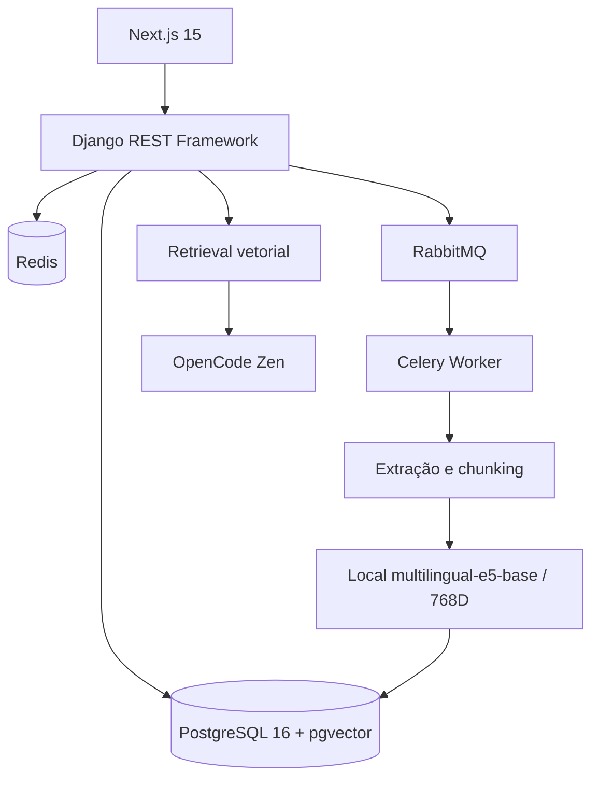

# Arquitetura do GovIntel AI

O limite de segurança principal é `company_id` derivado do usuário autenticado. Toda consulta de edital, chunk, conversa e cache deve incluir esse limite.

O upload cria uma tarefa Celery e retorna antes do processamento. O worker preserva página e trecho de cada chunk para que o chat consiga devolver citações verificáveis.

LLM e embeddings são configurações independentes. O embedding local usa os
prefixos `passage:` e `query:`, batch CPU, normalização L2 e fingerprint
persistido no chunk. O retrieval exige a identidade completa do fingerprint,
não somente o provider. A reindexação grava uma geração staged para todo o
conjunto selecionado e promove em transação; a geração anterior é preservada
para rollback.
